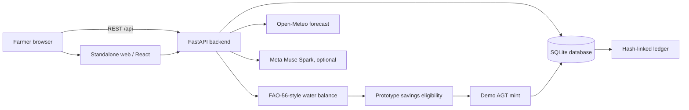

# Architecture — AgroToken MVP

## Operational workflow

1. Farmer selects farm (area, crop, growth stage, irrigation, location).
2. Open-Meteo returns forecast ETo, precipitation; manual demo values work when offline.
3. `estimate()` computes ETc, net rain-adjusted irrigation need, recommended gross irrigation, and a **hypothetical** inefficient-irrigation reference baseline.
4. Farmer enters a *simulated* meter volume and an ISO week.
5. Server rejects claims below the prototype screening threshold, above the baseline or already minted for the farm/week.
6. Server mints `floor(savings_m3 × 10)` demo AGT (subject to caps). **No real proof is asserted.**
7. In the same SQLite transaction, the mint increases wallet balance, creates a proof record, and appends a SHA-256-linked ledger entry.
8. Wallet transfers and demo purchases also update wallet, stock and ledger atomically.

## Why this is not a blockchain or a verified water credit

A hash chain provides detectable integrity against uncoordinated edits. There is **no network consensus, token ownership on-chain, validator quorum, digital signature from meters or external anchored checkpoint**. Anyone with control over the database can replace the chain with recomputed hashes. The proof evidence is explicitly `demo_sensor` with `verification=SIMULATED_ONLY`; actual irrigation use is not verified.

A real incentive requires monitoring, reporting and verification (MRV), dependable baselines, protection against under-irrigation, audit sampling, crop/soil validation, and economic partners who accept tokens. No token has intrinsic value just because supply is limited. Governments or institutions would require governance agreements and legal assessment.

## Database entities

- `farmers`: demo identities and balances
- `farms`: crop, stage, area, soil, irrigation, location
- `proofs`: per-week simulated inputs, reference, net savings, reward, ledger block
- `products`: example prices/stock
- `orders`: demo redemptions
- `transfers`: transfers between local demo farmers
- `ledger`: genesis/mint/redeem/transfer hash chain

## Trust boundaries

- The **backend** owns all calculations, mints, wallet and ledger writes.
- The frontend never calculates/updates balances directly.
- Meta API keys stay only as server environment variables.
- Manual sensor readings are *not* trusted in production.
- Open endpoints and unauthenticated demo users make the application suitable only for a controlled prototype, not public production.
